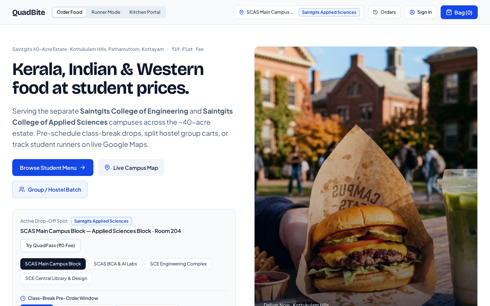
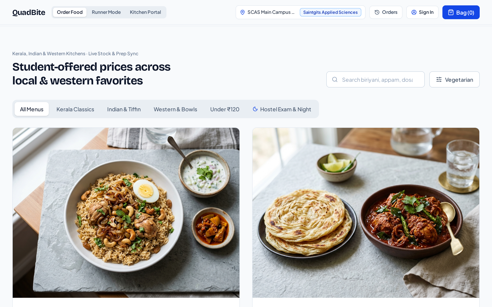
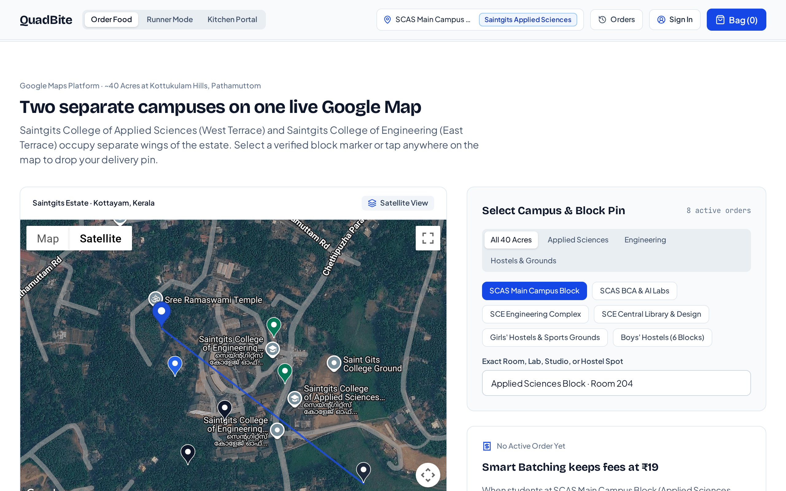
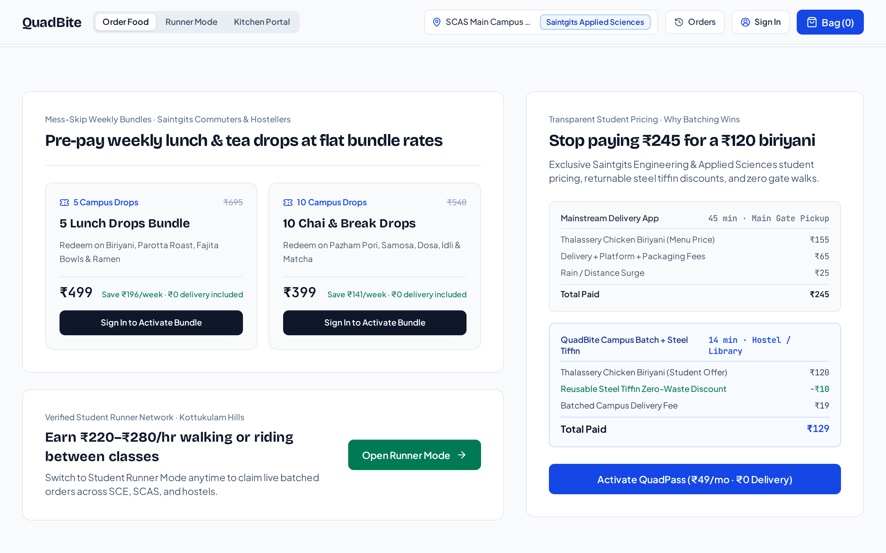
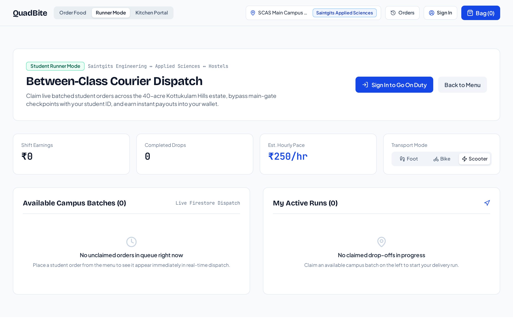
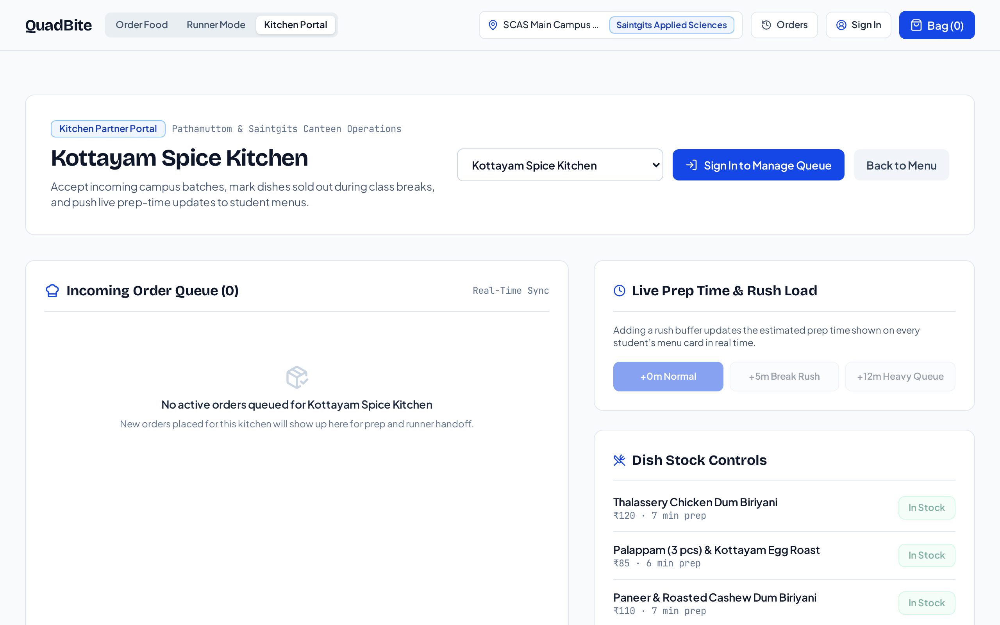

# QuadBite — Campus-Powered Food & Tiffin Delivery for Saintgits (Pathamuttom, Kottayam)

**QuadBite** is a hyperlocal, multi-role campus food ordering, break-slot batching, and peer-runner logistics web application built for the ~40-acre **Saintgits Group of Institutions** estate in Pathamuttom, Kottayam, Kerala—serving both **Saintgits College of Engineering (SCE)** and **Saintgits College of Applied Sciences (SCAS)** alongside residential hostels and nearby eateries.

> **Project Context — Google Generative AI Leader Certification Portfolio:**  
> This application was conceptualized, architected, and delivered as a practical capstone/portfolio project aligned with **Google's Generative AI Leader Certification**—demonstrating how modern AI-assisted product engineering, Google Cloud ecosystem services (Firebase & Google Maps Platform), unit-economics optimization, and security-by-design governance translate into a production-ready real-world digital product.

---

## Executive Summary & Business Value

Traditional food delivery platforms struggle on sprawling rural/suburban university campuses due to gate security restrictions, long walking distances across multi-building estates, high per-order delivery fees, and synchronized class-break demand spikes.

**QuadBite** solves these challenges through:
- **Two-Campus Precision:** Distinct campus badges, drop-off coordinates, and zone filters separating **Saintgits Engineering Campus (East Terrace)**, **Saintgits Applied Sciences Campus (West Terrace)**, and **Shared Hostels & Grounds**.
- **Synchronized Break-Slot Batching:** Consolidates individual student orders into scheduled campus windows (*10:45 AM Tea Break*, *12:35 PM Lunch Rush*, *4:00 PM Snacks*, *8:30 PM Hostel Night*)—keeping batched delivery fees at **₹19** (or **₹0** with QuadPass / Lunch Bundle credits).
- **Three-Sided Marketplace Orchestration:** Real-time Firestore synchronization connects **Students**, **Student Runners** (peer couriers earning pocket money between classes), and **Kitchen Partners** (canteen & local eatery staff managing rush prep delays and sold-out items).
- **Sustainability & Student Affordability:** **Reusable Steel Tiffin (−₹10)** zero-waste discount, **Campus Meal Wallet**, **Group / Hostel Batch Links** with per-person UPI split calculations, and **Weekly Mess-Skip Meal Bundles**.

---

## App Screenshots

| Campus Ordering & Break-Slot Hero | Kerala, Indian & Western Student Menu |
| :---: | :---: |
|  |  |

| Two-Campus Live Google Maps Tracker | Mess-Skip Bundles & Steel Tiffin Savings |
| :---: | :---: |
|  |  |

| Student Runner Dispatch Portal | Kitchen Partner Live Operations Portal |
| :---: | :---: |
|  |  |

> 🎥 **[Watch Full App Walkthrough Video (WebM)](docs/video/quadbite_walkthrough.webm)** — A complete end-to-end recorded demonstration showcasing student campus ordering, break-slot scheduling, live Google Maps routing across the 40-acre estate, Student Runner mode, and Kitchen Partner operations.

---

## Alignment with Google Generative AI Leader Principles

| Certification Pillar | How QuadBite Applies It |
| :--- | :--- |
| **Strategic Business Case & Unit Economics** | Replaces fragmented single-order trips with break-window batching (`₹19` flat fee), group hostel carts, and weekly bundles (*5 Lunch Drops · ₹499*, *10 Chai Drops · ₹399*) to maximize order density and student affordability. |
| **Google Ecosystem & Cloud Modernization** | Built on **Firebase Authentication**, **Cloud Firestore** (real-time `onSnapshot` state sync), and **Google Maps Platform** (`@vis.gl/react-google-maps` + Routes API) with zero manual server maintenance. |
| **Security, Privacy & Governance** | Enforces fail-closed **Firestore Security Rules** (`firestore.rules`) validated with `@firebase/eslint-plugin-security-rules`, owner-isolated user wallets/profiles, terminal order state locks, and scoped browser API keys. |
| **AI-Driven Product Velocity** | Designed and iterated using structured AI-assisted product specification, schema-first data modeling (`firebase-blueprint.json`), adversarial security rule verification (`security_spec.md`), and modular TypeScript architecture. |
| **Responsible & Sustainable Design** | Incentivizes zero-waste behavior via reusable steel tiffins (−₹10) and transparent student-courier fair payouts across campus paths. |

---

## Key Features

### 1. Multi-Role Views & Real-Time Persistence (Firebase)
- **Student Sign-In & Campus Profile (`AuthProfileDrawer`):** Google Sign-In syncing verified campus (`Engineering Campus` vs `Applied Sciences Campus`), department/year, up to 8 saved drop-off pins, **QuadPass**, **Meal Wallet**, and cross-device **Order History**.
- **Student Runner Portal (`RunnerPortalView`):** Toggle on-duty status, select transport mode (`Walk`, `Cycle`, `EV Scooter`), claim queued campus batches, advance delivery stages live, and track shift earnings.
- **Kitchen Partner Portal (`KitchenPortalView`):** Accept incoming orders (`queued` → `preparing` → `ready`), adjust rush prep-time offsets (`0–45 min`), and toggle sold-out dishes synced instantly to the student menu.

### 2. Interactive 40-Acre Campus Map (Google Maps Platform)
- Powered by `@vis.gl/react-google-maps` with **Maps JavaScript API** (`AdvancedMarker`, `Pin`, `InfoWindow`) and **Routes API** (`useMapsLibrary('routes')`).
- **Satellite / Road Toggle**, **Click-to-Drop Custom Estate Pins** with auto-inferred campus wing coordinates, **Live Moving Runner Pin**, and route distance/duration calculation from **Pathamuttom Kitchen Hub** to any block or hostel.

### 3. Class-Break Scheduling, Group Carts & Hostel Night Mode
- **Break-Slot Pre-Ordering:** Schedule meals directly into class tea breaks, lunch hours, or evening hostel windows.
- **Group / Hostel Batch Links (`?batch=<id>`):** Share a live room link with lab classmates or hostel roommates so everyone adds their own meal into one batched delivery and copies an automatic **Per-Person UPI Split**.
- **Hostel Late-Night & Exam Menu:** Dedicated menu mode spotlighting evening chai, Kerala snacks, and study combos for residential hostel pins.

### 4. Smarter Campus Payments & Savings
- **Campus Meal Wallet:** Instant `+₹100` / `+₹250` / `+₹500` top-ups with one-tap checkout and shortfall guardrails.
- **Reusable Steel Tiffin (−₹10):** Opt-in returnable canteen tiffin discount on eligible Kerala meals and combos.
- **Weekly Mess-Skip Bundles:** Redeemable **5 Lunch Drops (₹499)** and **10 Chai & Break Drops (₹399)** credits.

---

## Tech Stack

- **Frontend:** React 19, TypeScript, Vite 8, Tailwind CSS v4, Lucide React, Motion
- **Backend / Database / Auth:** Firebase v13 (Google Authentication & Cloud Firestore)
- **Mapping & Routing:** Google Maps Platform (`@vis.gl/react-google-maps`, Maps JS API, Routes API)
- **Security & Tooling:** ESLint + `@firebase/eslint-plugin-security-rules`, TypeScript (`tsc --noEmit`)

---

## Project Structure

```text
├── firebase-blueprint.json     # Schema & entity definitions (UserProfile, CampusOrder, etc.)
├── firestore.rules             # Fail-closed Firestore security rules
├── security_spec.md            # Security invariants & adversarial test matrix
├── eslint.config.js            # Security rules linter config
├── vite.config.ts              # Vite + environment configuration
├── .env.example                # Required environment variable template
├── docs/
│   └── screenshots/            # Application reference screenshots for README
└── src/
    ├── App.tsx                 # Main orchestration, role switching & Firestore listeners
    ├── main.tsx                # Entry point & Maps quota error listener
    ├── types/quadbite.ts       # Domain TypeScript interfaces
    ├── data/campusData.ts      # Saintgits campus pins, Kerala/campus dishes, break slots & bundles
    ├── lib/firebase.ts         # Firebase initialization, auth helpers & input sanitizers
    └── components/
        ├── AuthProfileDrawer.tsx
        ├── CampusMapTracker.tsx
        ├── CartDrawer.tsx
        ├── CourierAndPassSection.tsx
        ├── DishModal.tsx
        ├── ErrorBoundary.tsx
        ├── Footer.tsx
        ├── HeroSection.tsx
        ├── KitchenPortalView.tsx
        ├── MarketplaceSection.tsx
        ├── Navbar.tsx
        ├── OrderHistoryDrawer.tsx
        ├── ResilientImage.tsx
        └── RunnerPortalView.tsx
```

---

## Getting Started (Local Development)

### 1. Prerequisites
- Node.js 20+
- A Firebase project with **Authentication (Google Sign-In)** and **Cloud Firestore** enabled
- A Google Cloud project with **Maps JavaScript API** and **Routes API** enabled

### 2. Install Dependencies
```bash
npm install
```

### 3. Configure Environment Variables
Copy `.env.example` to `.env` and set your browser-restricted Google Maps API key:
```env
VITE_GOOGLE_MAPS_API_KEY="YOUR_GOOGLE_MAPS_BROWSER_API_KEY"
```
Ensure `firebase-applet-config.json` points to your Firebase project and Firestore database ID.

### 4. Run the Development Server
```bash
npm run dev
```
The app runs at `http://localhost:3000`.

### 5. Build & Verification
```bash
# TypeScript type check
npm run lint

# Security rules validation
npx eslint firestore.rules

# Production build
npm run build
```

---

## Security Highlights
- **Authenticated Writes Only:** Anonymous/unauthenticated writes to Firestore are denied.
- **Owner-Isolated User Data:** Students can only read and update their own profile, wallet balance, QuadPass, and saved pins (`/users/{uid}`).
- **Terminal State Locks:** Delivered orders (`status == 'delivered'`) and placed group batches (`status == 'placed'`) are immutable against tampering.
- **API Key Hygiene:** Restrict `VITE_GOOGLE_MAPS_API_KEY` via HTTP referrers and restrict enabled APIs to **Maps JavaScript API** and **Routes API** in Google Cloud Console before public deployment.

---

## Author & Certification Note
Built as part of learning and demonstrating cloud architecture, product strategy, and Google Cloud / AI-accelerated engineering practices for the **Google Cloud Generative AI Leader Certification**.
